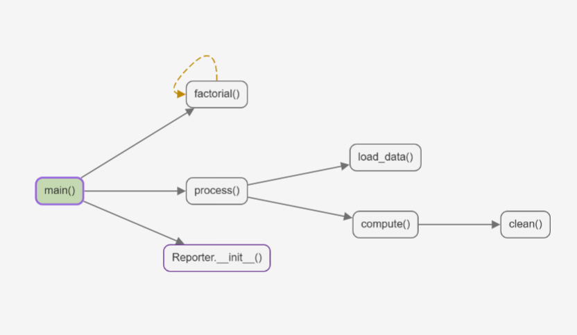

# PyCallMap

把 Python 文件里的函数调用关系画成一张横向调用图，点击节点即可跳到对应代码。

PyCallMap visualizes the function call graph of a single Python file as an
interactive left-to-right diagram. Click a node to jump to its definition.



## 功能

- 横向有向调用图，每个函数只出现一次
- 递归和互相调用用琥珀色虚线回边表示
- 顶层函数、类方法、嵌套函数
- 自动识别入口（模块级调用、`if __name__ == "__main__":`、`main`）
- 未调用函数默认隐藏，可一键显示
- 点击节点跳到函数定义，点击边跳到调用位置
- 光标移动时高亮当前函数
- 保存文件自动刷新
- 跟随 VSCode 深色/浅色主题
- 所有分析在本地完成，无网络请求、无遥测

## 安装

### 从 VSIX 安装

1. 下载发布附件中的 `.vsix` 文件。
2. 在 VSCode 中打开扩展视图，点击右上角 `...`，选择 `Install from VSIX...`。
3. 选择下载的 `.vsix` 文件。

### 开发模式

```bash
npm install
npm run build
```

在 VSCode 中按 F5 启动 Extension Development Host。

## 使用

1. 打开一个 `.py` 文件。
2. 执行命令 `PyCallMap: Show Function Call Graph`，或点击编辑器标题栏的图图标。
3. 在右侧面板查看调用图。

## 支持的写法

- 同一文件内的顶层函数、类方法、嵌套函数
- `self.foo()`、`cls.foo()`、`ClassName.foo()`、无参 `super().foo()`
- 同一文件内的类继承
- `ClassName()` 和类方法里的 `cls()` 会连到 `__init__`
- 递归、互相调用
- `async def`

## 已知限制

- 只分析当前文件，不追踪 import 或其他文件
- 不做局部变量类型推断，所以 `obj = MyClass(); obj.foo()` 不会连边
- 不解析函数别名、`getattr`、`eval`、回调注册、装饰器内部调用
- 多继承使用同文件父类的深度优先近似，不保证精确 MRO
- 被跳过的调用会计入所在函数的「外部调用」数量

## 设置

| 设置 | 默认值 | 说明 |
| --- | --- | --- |
| `pyCallMap.pythonPath` | `""` | 指定 Python 解释器；留空时自动查找 `.venv` 和 PATH |
| `pyCallMap.autoRefreshOnSave` | `true` | 保存绑定的 Python 文件时自动刷新 |
| `pyCallMap.showUncalledByDefault` | `false` | 首次打开时显示不可达函数 |

## 隐私

PyCallMap 只读取当前 Python 文件并在本地运行标准库分析脚本。它不发送任何数据，不包含遥测，也不执行用户代码。

## 开发

```bash
npm run typecheck
npm test
python -m unittest discover -s test/python -p "test_*.py" -v
npm run build
npm run package
```

## English summary

PyCallMap renders a single Python file's function call graph as an interactive
left-to-right diagram. It supports top-level functions, methods, nested
functions, recursion, entry detection, click-to-code navigation, and cursor
highlighting. Analysis runs locally with Python's standard library; no code is
executed and no data leaves the machine.

## License

MIT
